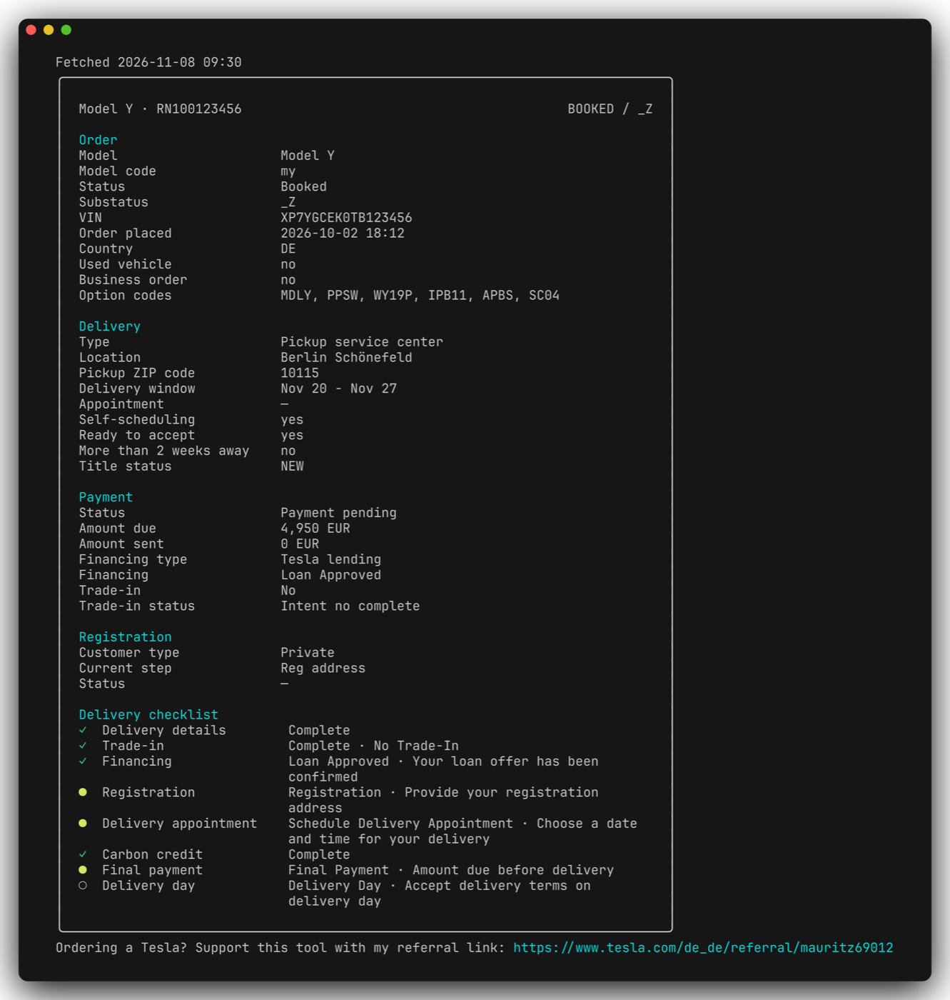

# tesla-order-cli



<sub>Example output with demo data (`tesla-order-cli show -i docs/demo-orders.json`).</sub>

Show your Tesla order details (status, delivery, payment, the app's delivery checklist) and what
changed since the last check: delivery window, VIN, appointment and so on.

A single binary for macOS, Linux and Windows.

- **Login once, in your normal browser.** On macOS a tiny helper app is registered for `tesla://`
  links, so when Tesla redirects there after login, the callback lands straight in the tool. No
  copying URLs out of DevTools, and no automated browser for Tesla's bot protection to block.
- **Stays logged in.** Expired access tokens are refreshed, and Tesla's rotated refresh token is
  saved every time, so you rarely have to log in again.
- **Shows what changed.** Each `check` compares with the last snapshot and lists the differences.

## Platform support

| | macOS | Linux | Windows |
|---|---|---|---|
| `check`, `show`, `dump`, output formats, `--debug` | ✓ tested | builds, not tested | builds, not tested |
| Login | ✓ **automatic** | manual: paste the callback URL | manual: paste the callback URL |

**The automatic login only works on macOS.** It needs the `tesla://` helper app, which is
macOS-only. On Linux and Windows, `login` opens the browser and you paste the
`tesla://auth/callback?code=...` URL from the browser's Developer Tools into the terminal.
**Linux and Windows are not tested**; the binaries are built for them, but expect rough edges.

**Only tested with a German order so far.** Orders from other countries may return different
fields or values, so some details could be missing or shown as `—`. Use `--country` for your
country code, and if something looks off, `dump` shows the raw data. An issue with what you see
(with personal data removed) helps a lot.

## Install

Download the archive for your system from the
[latest release](https://github.com/mauritzuph/tesla-order-cli/releases/latest), unpack it
and put `tesla-order-cli` somewhere on your `PATH`.

| System | Archive |
|---|---|
| macOS, Apple Silicon | `tesla-order-cli_<version>_darwin_arm64.tar.gz` |
| macOS, Intel | `tesla-order-cli_<version>_darwin_amd64.tar.gz` |
| Linux | `tesla-order-cli_<version>_linux_amd64.tar.gz` (or `_arm64`) |
| Windows | `tesla-order-cli_<version>_windows_amd64.zip` (or `_arm64`) |

**macOS:** the binary isn't signed by Apple, so Gatekeeper blocks a downloaded copy. Remove the
quarantine flag once:

```bash
xattr -d com.apple.quarantine ./tesla-order-cli
```

Verify a download against `checksums.txt` from the same release:

```bash
shasum -a 256 -c checksums.txt --ignore-missing
```

Or build from source with Go:

```bash
go install github.com/mauritzuph/tesla-order-cli/cmd/tesla-order-cli@latest
```

Or run it straight from a clone, without installing anything:

```bash
git clone https://github.com/mauritzuph/tesla-order-cli.git
cd tesla-order-cli
go run ./cmd/tesla-order-cli login
go run ./cmd/tesla-order-cli check
```

## Usage

```bash
# 1. Log in (once)
tesla-order-cli login

# 2. Show your order (the first check saves a baseline for later comparisons)
tesla-order-cli check

# 3. Later: show the order again plus what changed since last time
tesla-order-cli check
```

### How login works

**macOS (automatic):** `login` opens the Tesla login page in your default browser. After you log
in, Tesla redirects to `tesla://auth/callback?code=...`. Your browser asks whether it may open
**TeslaOrderCLICallback**: allow it, and the login finishes in the terminal by itself.

The helper app is created on first login in `~/.tesla-order-cli/` and registered with macOS as
the handler for `tesla://` links. It does nothing except write the URL it receives to
`~/.tesla-order-cli/callback.txt`. Remove it with `url-handler uninstall`.

If the browser shows no prompt, open the Developer Tools (Cmd+Option+I), find the `tesla://` URL in
the Console or Network tab and **copy** it. The tool watches the clipboard, so there's no need to
paste it.

**Linux and Windows (manual, not tested):** `login` opens the login page and waits. After logging
in, open the Developer Tools (F12), copy the `tesla://auth/callback?code=...` URL from the Console
or Network tab and paste it into the terminal. `login --manual` does the same on macOS.

If Tesla's bot protection blocks your browser, try another one: `login --browser firefox` (or
`safari`, `chrome`, `edge`, `brave`, ...).

### Commands

| Command | What it does |
|---|---|
| `login` | Log in. `--browser NAME`: use another browser. `--manual`: paste the callback URL yourself. `--no-handler`: skip the helper app, only watch the clipboard (macOS). |
| `check [-q] [-f FORMAT] [--all]` | Fetch orders, print the summary and what changed since the last check. `-q`: only the changes. Never prompts. |
| `show [-f FORMAT] [--all] [-i FILE]` | Print the last saved snapshot without network access, or a snapshot/`dump` file. |
| `dump [-o FILE] [-f json\|yaml]` | Print the raw API data (saves nothing). |
| `url-handler install\|uninstall\|status` | Manage the macOS `tesla://` helper app (`login` installs it for you). |
| `logout` | Delete stored tokens. |

`check` also accepts `--country` (default `DE`) and `--ignore GLOB` to silence noisy fields, e.g.
`--ignore '*.lastUpdated'`. By default, change detection ignores the UI text and app layout parts
of the response (`details.strings`, `details.state`), so a reworded button doesn't show up as a
change.

Exit codes: `0` ok, `1` error (network, API), `2` login required.

## Output formats

`show` and `check` print a summary in one of four formats with `-f` / `--format`:

```bash
tesla-order-cli show                  # pretty (default): sections + delivery checklist
tesla-order-cli show -f table         # tables with raw values (PICKUP_SERVICE_CENTER, ...)
tesla-order-cli show -f json          # structured summary, for scripts and jq
tesla-order-cli show -f yaml
tesla-order-cli show --all            # plus every raw data field (UI text excluded)
tesla-order-cli show -i orders.json   # render a `dump` output file
```

The summary contains:

| Section | Fields |
|---|---|
| Order | model, status and substatus, VIN, factory, model year, steering side and serial number (decoded from the VIN), order placed, reservation and booked dates, country, used/business order, option codes |
| Delivery | type (pickup/delivery), delivery center, pickup ZIP code, delivery window, appointment, self-scheduling link, vehicle ready, ready to accept, vehicle located, more than 2 weeks away, title status, ETA to delivery center, routing location, odometer |
| Payment | final payment status, amount due and sent, financing type and status (e.g. "Credit Decision Pending"), credit application, trade-in |
| Registration | customer type, current step, status, expected registration date, status flags |
| Delivery checklist | the task list from the Tesla app in app order: ✓ done, ● open now, ○ not open yet, with the app's own status text |

Tesla moves fields around between accounts and order stages, so each value is looked up in every
known location (for example `orderDetails` under `registration` *or* `deliveryDetails`).
Fields Tesla doesn't send for your order are hidden in pretty/table output and `null` in JSON/YAML.
Tasks the tool doesn't know yet still show up in the checklist. Colors are turned off
automatically when the output isn't a terminal.

The pretty format ends with one line pointing to the author's
[Tesla referral link](https://www.tesla.com/de_de/referral/mauritz69012). Table, JSON and YAML
output don't include it.

## Permissions

The tool only asks Tesla for `openid email offline_access`, which is enough to read orders. Some
forks also add `vehicle_device_data vehicle_cmds vehicle_charging_cmds`. That lets the saved token
read vehicle data and send commands to the car (unlock, climate, charging), which an order tracker
doesn't need. A token stored on disk shouldn't be able to do that.

## Where data lives

`~/.tesla-order-cli/` (override with `--data-dir` or `TESLA_ORDER_CLI_HOME`):

- `tokens.json`: your Tesla tokens, readable only by your user (mode `0600` on macOS/Linux). Treat
  it like a password.
- `orders.json`: the last snapshot, used to show what changed.
- `TeslaOrderCLICallback.app`: the `tesla://` helper (macOS).
- `debug/`: request/response dumps from `--debug` runs. Safe to delete.

## Debugging the API

`--debug` dumps every API request and response: method, URL, request body, status code,
response headers, response body and timing. It works with any command; put it before the
command name:

```bash
tesla-order-cli --debug check
tesla-order-cli --debug login
```

Each request is printed to stderr and also written to its own JSON file in
`~/.tesla-order-cli/debug/<timestamp>/` (choose another folder with `--debug-dir`), e.g.
`01-POST-auth_tesla_com_oauth2_v3_token.json`. Error responses are recorded too. Look there for
Tesla's actual answer when a request fails with `401`/`403`, or for an HTML bot-protection page
instead of JSON.

To see everything the API returns, without saving a snapshot:

```bash
tesla-order-cli dump                    # print to stdout
tesla-order-cli dump -o orders.json     # write to a file
tesla-order-cli --debug dump            # plus the full request/response log
```

`dump` prints the raw order list, the details for each order, and the decoded access-token
claims (expiry, scopes, audience). `-v` / `--verbose` gives debug logging without the dumps.

**Privacy:** access tokens, refresh tokens, auth codes, PKCE verifiers, `Authorization` headers and
cookies are always replaced by `<redacted N chars>`. Order data is **not** redacted: your name,
address, VIN and the like end up in the dumps. The files are only readable by your user account.
Check them before sharing them anywhere.

## How the Tesla API access works

Tesla's auth server fingerprints the TLS handshake: a token obtained with a non-browser handshake
is rejected by the order API with `403 forbidden`. The tool therefore imitates Chrome's TLS and
HTTP/2 fingerprint using [bogdanfinn/tls-client](https://github.com/bogdanfinn/tls-client). If
Tesla changes its checks, logins or token refreshes may start failing until the Chrome profile in
`internal/httpx` is updated.

## Development

Requires Go (see `go.mod` for the version).

```bash
go test ./...
go vet ./...
gofmt -l .
go build ./cmd/tesla-order-cli
```

All network access goes through the `httpx.Client` interface, so the tests use a fake client and
never touch Tesla.

| Package | Contents |
|---|---|
| `cmd/tesla-order-cli` | entry point |
| `internal/cli` | commands and flags |
| `internal/auth` | OAuth2 PKCE login, token refresh |
| `internal/httpx` | HTTP client with Chrome TLS impersonation, request recording |
| `internal/api` | Tesla order endpoints |
| `internal/tracker` | `check`: fetch, compare, save |
| `internal/summary`, `internal/render` | summary extraction, pretty/table/json/yaml output |
| `internal/urlhandler`, `internal/callback` | macOS `tesla://` helper, login callback sources |
| `internal/debug` | `--debug` dumps and redaction |

CI and the release workflow scan the files and the full git history with
[gitleaks](https://github.com/gitleaks/gitleaks); a found secret fails CI and stops the release.
Run the same scan locally before pushing:

```bash
gitleaks git . --redact && gitleaks dir . --redact
```

## Contributing

Contributions are welcome! Feel free to open an
[issue](https://github.com/mauritzuph/tesla-order-cli/issues) for bugs, ideas or questions, or send a
[pull request](https://github.com/mauritzuph/tesla-order-cli/pulls). Reports from Linux and Windows
users are especially helpful.

## License

[MIT](LICENSE)

## Disclaimer

Uses unofficial Tesla endpoints that can change without notice. Not affiliated with Tesla.
Inspired by [niklaswa/tesla-order-status](https://github.com/niklaswa/tesla-order-status).
